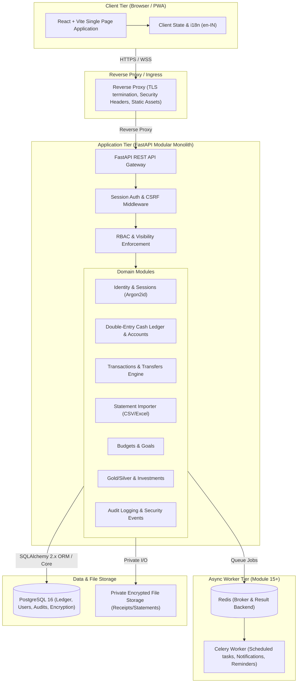

# Architecture Documentation: Smart Family Budget Manager

## 1. System Overview & Architectural Pattern
The **Smart Family Budget Manager** is designed as a **modular monolith** optimized for private home or single-family deployment in India. It prioritizes financial accuracy, data confidentiality, strict isolation, and operational simplicity.



---

## 2. Trust Boundaries & Security Zones

1. **Untrusted Zone (Public Network / Internet)**:
   - External browsers, mobile devices, potential attackers.
   - All input is considered hostile.
   - Enforced by TLS (HTTPS), CSP, HSTS, Secure/HttpOnly/SameSite cookies, CORS origin allowlists, and IP-based rate limiting.

2. **Ingress Boundary (Reverse Proxy / TLS Termination)**:
   - Enforces TLS termination, static file serving, compression, and request body size limits (max 10MB for uploads).
   - Drops malformed HTTP requests before hitting the application server.

3. **Application Execution Boundary (FastAPI Runtime)**:
   - Server-side session verification.
   - CSRF token validation on all state-changing endpoints (`POST`, `PUT`, `PATCH`, `DELETE`).
   - Strict Pydantic v2 schemas for request parsing and response filtering (internal IDs, hashed credentials, and encryption keys never leak).
   - Household context and record visibility filters applied on every query.

4. **Persistence & Data Boundary (PostgreSQL & Encrypted Disk)**:
   - Private network access only (isolated Docker network or localhost; never exposed on `0.0.0.0`).
   - Strong role privileges for the application user.
   - Sensitive fields encrypted with AES-256-GCM before reaching disk.

---

## 3. Data Flow Architecture

### 3.1 Authentication & Session Life Cycle
1. **Login Request**: User posts `username`/`email` and `password` with a CSRF token.
2. **Argon2id Verification**: Backend verifies password against salt and hash stored in `users`.
3. **Session Creation**: Generates cryptographically secure 256-bit random session token. Stored hashed in `user_sessions` with expiration and idle timeout (default 7 days absolute, 2 hours idle).
4. **Cookie Issuance**: Sent via `Set-Cookie` (`HttpOnly`, `Secure`, `SameSite=Strict`, `Path=/`).
5. **State-Changing Requests**: Client must provide the session cookie plus a matching CSRF token header (`X-CSRF-Token`).
6. **Session Revocation**: User can invalidate current session or invoke "Log out everywhere" to invalidate all sessions across devices.

### 3.2 Transaction & Double-Leg Transfer Flow
1. **Initiation**: User creates a transfer (e.g., Bank Savings to Cash / ATM withdrawal) with an `idempotency_key`.
2. **Validation**: Pydantic validates currency (`INR`), positive amount (`NUMERIC(14,2)`), valid source and destination accounts.
3. **Database Transaction (`BEGIN`)**:
   - Acquire locks on source and destination accounts (or use optimistic locking via version column).
   - Create parent `transfer_group` with total amount, household_id, user_id, date, and description.
   - Insert source leg: debit account, negative impact on asset, linked to `transfer_group_id`.
   - Insert destination leg: credit account, positive impact on asset, linked to `transfer_group_id`.
   - Generate immutable `audit_logs` record with previous and new states.
4. **Commit (`COMMIT`)**: Both legs persist atomically. If either leg fails, entire transaction rolls back.

---

## 4. Directory Structure (Modular Monolith)

```
Finanial Manager/
├── AGENTS.md                          # Standing rules & working agreement
├── ARCHITECTURE.md                    # System architecture & structure (this file)
├── DATABASE_DESIGN.md                 # Schemas, ERD, Ledger rules & RLS
├── DEVELOPMENT_ROADMAP.md             # Phased modules & dependency graph
├── DEVELOPMENT_STATUS.md              # Live status tracker
├── MODULE_CHECKLIST.md                # Acceptance criteria per module
├── KNOWN_ISSUES.md                    # Technical debt, bugs & pending items
├── DECISIONS.md                       # Architectural Decision Records (ADRs)
├── SECURITY.md                        # Security policies & incident handling
├── SECURITY_CHECKLIST.md              # Self-review security matrix
├── docs/                              # Project specifications & blueprint
│   └── BLUEPRINT.pdf                  # Product specification PDF
├── backend/                           # FastAPI Application
│   ├── alembic/                       # Alembic migrations
│   │   ├── versions/
│   │   └── env.py
│   ├── app/
│   │   ├── api/                       # API routes (versioned)
│   │   │   ├── v1/
│   │   │   │   ├── auth.py
│   │   │   │   ├── households.py
│   │   │   │   ├── accounts.py
│   │   │   │   ├── transactions.py
│   │   │   │   ├── transfers.py
│   │   │   │   ├── categories.py
│   │   │   │   ├── budgets.py
│   │   │   │   ├── analytics.py
│   │   │   │   ├── imports.py
│   │   │   │   ├── investments.py
│   │   │   │   └── audit.py
│   │   │   └── router.py
│   │   ├── core/                      # Core configuration, security & database
│   │   │   ├── config.py              # Environment settings (Pydantic Settings)
│   │   │   ├── database.py            # SQLAlchemy async/sync engine & session factory
│   │   │   ├── security.py            # Argon2id hashing, session token crypto
│   │   │   ├── crypto.py              # AES-256-GCM field encryption & key management
│   │   │   ├── middleware.py          # Session auth, CSRF, security headers, rate limit
│   │   │   └── dependencies.py        # FastAPI dependency injection (get_current_user, etc.)
│   │   ├── models/                    # SQLAlchemy ORM Models
│   │   │   ├── base.py                # Base model with UUID, timestamps, version column
│   │   │   ├── user.py
│   │   │   ├── household.py
│   │   │   ├── account.py
│   │   │   ├── category.py
│   │   │   ├── transaction.py
│   │   │   ├── transfer.py
│   │   │   ├── budget.py
│   │   │   ├── investment.py
│   │   │   └── audit.py
│   │   ├── schemas/                   # Pydantic v2 Request/Response Schemas
│   │   │   ├── auth.py
│   │   │   ├── account.py
│   │   │   ├── transaction.py
│   │   │   ├── transfer.py
│   │   │   └── common.py
│   │   ├── services/                  # Business logic services
│   │   │   ├── ledger_service.py      # Balance calculation, double-leg consistency
│   │   │   ├── import_service.py      # Bank statement parsing & de-duplication
│   │   │   └── export_service.py      # Safe data export
│   │   └── main.py                    # Application entry point
│   ├── tests/                         # Pytest test suite
│   │   ├── conftest.py
│   │   ├── unit/
│   │   ├── integration/
│   │   ├── security/
│   │   └── financial/                 # Accounting rule & double-entry tests
│   ├── alembic.ini
│   ├── Dockerfile
│   └── pyproject.toml / requirements.txt
├── frontend/                          # React + Vite Application
│   ├── public/
│   │   ├── locales/                   # i18n JSON resources (en-IN, ta-IN future)
│   │   └── favicon.ico
│   ├── src/
│   │   ├── assets/
│   │   ├── components/                # Reusable UI components (buttons, modals, tables)
│   │   │   ├── common/
│   │   │   ├── layout/
│   │   │   └── forms/
│   │   ├── hooks/                     # Custom React hooks (useAuth, useAccounts)
│   │   ├── i18n/                      # i18n configuration (i18next)
│   │   ├── pages/                     # Routed view components
│   │   │   ├── Dashboard/
│   │   │   ├── Transactions/
│   │   │   ├── Accounts/
│   │   │   ├── Budgets/
│   │   │   ├── Investments/
│   │   │   └── Settings/
│   │   ├── services/                  # API client (Axios/Fetch with CSRF handling)
│   │   ├── utils/                     # Formatters (INR ₹ currency, Asia/Kolkata dates)
│   │   ├── App.jsx
│   │   ├── main.jsx
│   │   └── index.css
│   ├── tests/                         # Vitest + RTL test suite
│   ├── Dockerfile
│   ├── package.json
│   ├── tailwind.config.js
│   └── vite.config.js
├── docker-compose.yml                 # Local dev orchestration (PostgreSQL, App, Vite)
├── docker-compose.prod.yml            # Production deployment orchestration
└── .env.example                       # Documented environment variable template
```
