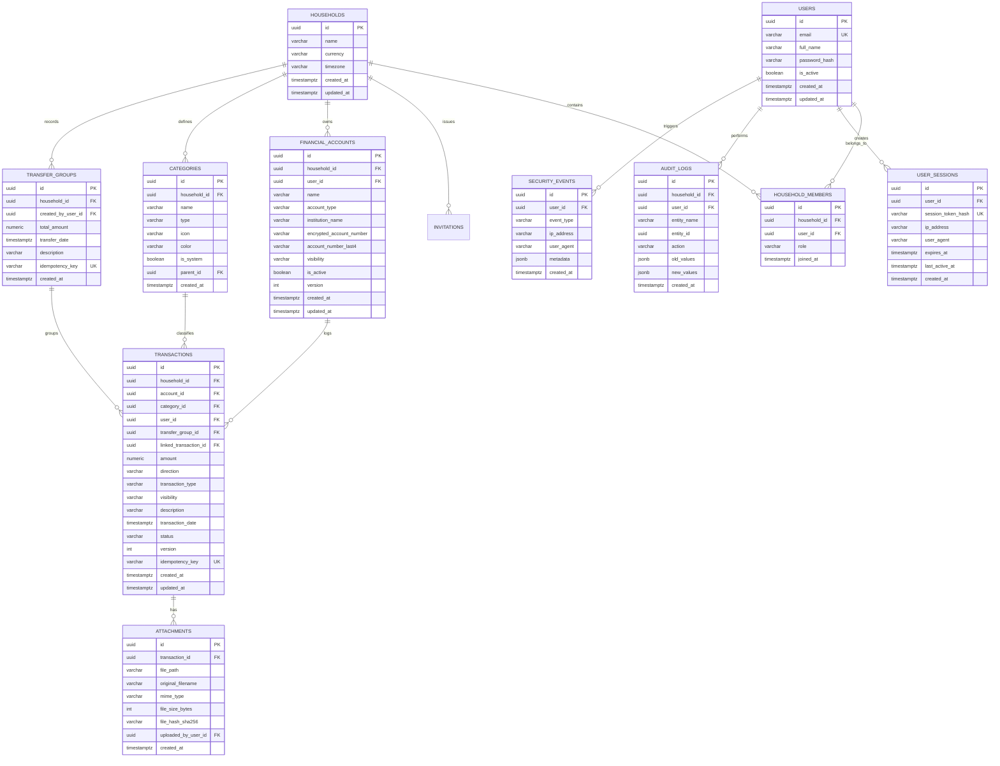

# Database Design: Smart Family Budget Manager

## 1. Overview & Core Principles
1. **Financial Accuracy First**: Derived balances, append-only ledger entries, double-entry transfer legs in atomic transactions, void/reversal workflows (no hard deletes).
2. **Numeric Precision**: All monetary values are strictly `NUMERIC(14,2)`. No floating-point types (`REAL`, `DOUBLE PRECISION`, `FLOAT`).
3. **Temporal Consistency**: UTC `timestamptz` for all real-time events. Date-only `DATE` for bills, EMIs, and calendar-aligned items in the `Asia/Kolkata` zone.
4. **Optimistic Concurrency**: Financial entities have a `version INT NOT NULL DEFAULT 1` column to prevent silent concurrent overwrites.
5. **Idempotency**: Critical financial modifications accept an `idempotency_key` unique per household and operation.

---

## 2. Entity-Relationship Diagram (Mermaid)



---

## 3. Table Catalog & Detailed Constraints

### 3.1 `households`
- `id`: UUID (Primary Key, default `gen_random_uuid()`)
- `name`: VARCHAR(100) NOT NULL
- `currency`: VARCHAR(3) NOT NULL DEFAULT 'INR'
- `timezone`: VARCHAR(50) NOT NULL DEFAULT 'Asia/Kolkata'
- `created_at`: TIMESTAMPTZ NOT NULL DEFAULT NOW()
- `updated_at`: TIMESTAMPTZ NOT NULL DEFAULT NOW()

### 3.2 `users`
- `id`: UUID (Primary Key)
- `email`: VARCHAR(255) NOT NULL UNIQUE (indexed, lowercase, trimmed)
- `full_name`: VARCHAR(100) NOT NULL
- `password_hash`: VARCHAR(255) NOT NULL (Argon2id format)
- `is_active`: BOOLEAN NOT NULL DEFAULT TRUE
- `created_at`: TIMESTAMPTZ NOT NULL DEFAULT NOW()
- `updated_at`: TIMESTAMPTZ NOT NULL DEFAULT NOW()

### 3.3 `household_members`
- `id`: UUID (Primary Key)
- `household_id`: UUID NOT NULL REFERENCES `households`(id) ON DELETE CASCADE
- `user_id`: UUID NOT NULL REFERENCES `users`(id) ON DELETE CASCADE
- `role`: VARCHAR(20) NOT NULL CHECK (`role` IN ('Owner', 'Administrator', 'Member', 'ReadOnly'))
- `joined_at`: TIMESTAMPTZ NOT NULL DEFAULT NOW()
- **Constraint**: `UNIQUE(household_id, user_id)`

### 3.4 `user_sessions`
- `id`: UUID (Primary Key)
- `user_id`: UUID NOT NULL REFERENCES `users`(id) ON DELETE CASCADE
- `session_token_hash`: VARCHAR(64) NOT NULL UNIQUE (SHA-256 hash of random session secret)
- `ip_address`: VARCHAR(45) NULL
- `user_agent`: TEXT NULL
- `expires_at`: TIMESTAMPTZ NOT NULL
- `last_active_at`: TIMESTAMPTZ NOT NULL DEFAULT NOW()
- `created_at`: TIMESTAMPTZ NOT NULL DEFAULT NOW()
- **Index**: `INDEX idx_user_sessions_lookup (session_token_hash, expires_at)`

### 3.5 `financial_accounts`
- `id`: UUID (Primary Key)
- `household_id`: UUID NOT NULL REFERENCES `households`(id) ON DELETE CASCADE
- `user_id`: UUID NOT NULL REFERENCES `users`(id) (Owner of the account within household)
- `name`: VARCHAR(100) NOT NULL
- `account_type`: VARCHAR(30) NOT NULL CHECK (`account_type` IN ('cash', 'savings', 'current', 'credit_card', 'loan', 'investment', 'wallet', 'other'))
- `institution_name`: VARCHAR(100) NULL
- `encrypted_account_number`: TEXT NULL (AES-256-GCM ciphertext)
- `account_number_last4`: VARCHAR(4) NULL CHECK (`account_number_last4` ~ '^[0-9]{4}$')
- `visibility`: VARCHAR(10) NOT NULL DEFAULT 'shared' CHECK (`visibility` IN ('private', 'shared'))
- `is_active`: BOOLEAN NOT NULL DEFAULT TRUE
- `version`: INT NOT NULL DEFAULT 1
- `created_at`: TIMESTAMPTZ NOT NULL DEFAULT NOW()
- `updated_at`: TIMESTAMPTZ NOT NULL DEFAULT NOW()
- **Index**: `INDEX idx_accounts_household (household_id, is_active)`

### 3.6 `categories`
- `id`: UUID (Primary Key)
- `household_id`: UUID NOT NULL REFERENCES `households`(id) ON DELETE CASCADE
- `name`: VARCHAR(100) NOT NULL
- `type`: VARCHAR(20) NOT NULL CHECK (`type` IN ('income', 'expense', 'transfer', 'investment'))
- `icon`: VARCHAR(50) NULL
- `color`: VARCHAR(20) NULL
- `is_system`: BOOLEAN NOT NULL DEFAULT FALSE
- `parent_id`: UUID NULL REFERENCES `categories`(id) ON DELETE SET NULL
- `created_at`: TIMESTAMPTZ NOT NULL DEFAULT NOW()
- **Constraint**: `UNIQUE(household_id, name, type)`

### 3.7 `transfer_groups`
- `id`: UUID (Primary Key)
- `household_id`: UUID NOT NULL REFERENCES `households`(id) ON DELETE CASCADE
- `created_by_user_id`: UUID NOT NULL REFERENCES `users`(id)
- `total_amount`: NUMERIC(14,2) NOT NULL CHECK (`total_amount` > 0)
- `transfer_date`: TIMESTAMPTZ NOT NULL
- `description`: TEXT NULL
- `idempotency_key`: VARCHAR(64) NULL UNIQUE
- `created_at`: TIMESTAMPTZ NOT NULL DEFAULT NOW()

### 3.8 `transactions`
- `id`: UUID (Primary Key)
- `household_id`: UUID NOT NULL REFERENCES `households`(id) ON DELETE CASCADE
- `account_id`: UUID NOT NULL REFERENCES `financial_accounts`(id) ON DELETE RESTRICT
- `category_id`: UUID NULL REFERENCES `categories`(id) ON DELETE SET NULL
- `user_id`: UUID NOT NULL REFERENCES `users`(id)
- `transfer_group_id`: UUID NULL REFERENCES `transfer_groups`(id) ON DELETE RESTRICT
- `linked_transaction_id`: UUID NULL REFERENCES `transactions`(id) ON DELETE RESTRICT
- `amount`: NUMERIC(14,2) NOT NULL CHECK (`amount` > 0 AND `amount` <= 100000000000.00)
- `direction`: VARCHAR(10) NOT NULL CHECK (`direction` IN ('INFLOW', 'OUTFLOW'))
- `transaction_type`: VARCHAR(30) NOT NULL CHECK (`transaction_type` IN (
    'INCOME', 'EXPENSE', 'TRANSFER_OUT', 'TRANSFER_IN',
    'REFUND', 'LOAN_DISBURSEMENT', 'LOAN_REPAYMENT',
    'INVESTMENT_BUY', 'INVESTMENT_SELL', 'OPENING_BALANCE'
  ))
- `visibility`: VARCHAR(10) NOT NULL DEFAULT 'shared' CHECK (`visibility` IN ('private', 'shared'))
- `description`: TEXT NULL
- `transaction_date`: TIMESTAMPTZ NOT NULL
- `status`: VARCHAR(20) NOT NULL DEFAULT 'POSTED' CHECK (`status` IN ('POSTED', 'VOIDED', 'REVERSED'))
- `version`: INT NOT NULL DEFAULT 1
- `idempotency_key`: VARCHAR(64) NULL UNIQUE
- `created_at`: TIMESTAMPTZ NOT NULL DEFAULT NOW()
- `updated_at`: TIMESTAMPTZ NOT NULL DEFAULT NOW()
- **Indexes**:
  - `INDEX idx_transactions_account_date (account_id, transaction_date DESC)`
  - `INDEX idx_transactions_household_date (household_id, transaction_date DESC)`
  - `INDEX idx_transactions_transfer_group (transfer_group_id)`

### 3.9 `audit_logs`
- `id`: UUID (Primary Key)
- `household_id`: UUID NOT NULL REFERENCES `households`(id) ON DELETE CASCADE
- `user_id`: UUID NULL REFERENCES `users`(id) ON DELETE SET NULL
- `entity_name`: VARCHAR(50) NOT NULL
- `entity_id`: UUID NOT NULL
- `action`: VARCHAR(20) NOT NULL CHECK (`action` IN ('CREATE', 'UPDATE', 'VOID', 'REVERSE'))
- `old_values`: JSONB NULL
- `new_values`: JSONB NULL
- `created_at`: TIMESTAMPTZ NOT NULL DEFAULT NOW()
- **Index**: `INDEX idx_audit_logs_entity (entity_name, entity_id)`

### 3.10 `security_events`
- `id`: UUID (Primary Key)
- `user_id`: UUID NULL REFERENCES `users`(id) ON DELETE SET NULL
- `event_type`: VARCHAR(50) NOT NULL CHECK (`event_type` IN (
    'LOGIN_SUCCESS', 'LOGIN_FAILURE', 'LOGOUT', 'PASSWORD_RESET_REQ',
    'PASSWORD_RESET_SUCCESS', 'SESSION_REVOKED', 'ACCESS_DENIED',
    'SENSITIVE_DATA_EXPORT'
  ))
- `ip_address`: VARCHAR(45) NULL
- `user_agent`: TEXT NULL
- `metadata`: JSONB NULL (Strictly minimal: reason, counter, no secrets or credentials)
- `created_at`: TIMESTAMPTZ NOT NULL DEFAULT NOW()
- **Index**: `INDEX idx_security_events_type_date (event_type, created_at DESC)`

---

## 4. Ledger Accounting Design & Invariants

### 4.1 Balance Derivation (No Editable Balance Columns)
Account balances are never stored as mutable numbers on the `financial_accounts` table. They are dynamically aggregated from valid posted transactions:

$$
\text{Account Balance} = \sum (\text{INFLOW amounts}) - \sum (\text{OUTFLOW amounts})
$$

*(For liability accounts such as Credit Cards and Loans, net liability is $\sum \text{OUTFLOW} - \sum \text{INFLOW}$)*.

Materialized balances or summary caching tables (if needed for high performance in Module 8+) will be strictly read-only derivatives recalculated from the ledger.

### 4.2 Invariant Guarantees
1. **Always Positive Amounts**: `amount > 0` constraint enforced at database level. Direction (`INFLOW` or `OUTFLOW`) specifies movement.
2. **Balanced Transfers**: Every transfer requires exactly one `transfer_group` with:
   - Exactly one `TRANSFER_OUT` leg on Source Account.
   - Exactly one `TRANSFER_IN` leg on Destination Account.
   - `amount(TRANSFER_OUT) == amount(TRANSFER_IN) == transfer_group.total_amount`.
   - Both legs created within the same atomic database transaction.
3. **No Hard Deletes**: Financial transactions are never removed via SQL `DELETE`. When correcting an entry:
   - Either mark status `VOIDED` with an audit trail, or
   - Post an explicit equal-and-opposite `REVERSAL` transaction referencing `linked_transaction_id`.
4. **Credit Card Settlement vs. Expense**:
   - Swiping a credit card: `OUTFLOW`, type `EXPENSE`, increases card liability.
   - Paying a credit card bill from Bank: `TRANSFER` from Bank (`OUTFLOW`) to Credit Card (`INFLOW`), settling liability. It is NOT an expense.
5. **Refunds**:
   - `INFLOW`, type `REFUND`, references `linked_transaction_id` of the original expense. In reporting, it reduces expense for that category, rather than inflating income.

---

## 5. Visibility Model & Authorization

### 5.1 Visibility Levels
Each financial account and transaction has a `visibility` attribute:
- `shared`: Visible to all authenticated members of the household who have read permissions.
- `private`: Visible **only** to the user who created/owns it (and Household Owner if configured by household policy).

### 5.2 IDOR & Query Enforcement
Every query at the service layer enforces household isolation and visibility:
```sql
SELECT * FROM transactions t
JOIN financial_accounts a ON t.account_id = a.id
WHERE t.household_id = :session_household_id
  AND (t.visibility = 'shared' OR t.user_id = :session_user_id)
  AND (a.visibility = 'shared' OR a.user_id = :session_user_id)
  AND t.id = :requested_id;
```
If a record exists in another household or is private to another user, the API returns **HTTP 404 Not Found** (never 403 Forbidden) to prevent enumeration of record existence.

---

## 6. Field-Level Encryption Decisions

| Table | Column | Sensitive? | Encryption Status | Justification / Trade-off |
|---|---|---|---|---|
| `users` | `password_hash` | Critical | Hashed (Argon2id) | One-way hashing with per-user salt. Never stored or decrypted in plain text. |
| `financial_accounts` | `encrypted_account_number` | High | **Encrypted (AES-256-GCM)** | Full account/card number. Not used for SQL filtering or math. Decrypted only in account settings. |
| `financial_accounts` | `account_number_last4` | Low | **Cleartext** | Last 4 digits used for UI recognition and statement reconciliation. Non-sensitive under standard threat models. |
| `transactions` | `amount` | High | **Cleartext (Unencrypted)** | **Must not be encrypted.** Required for SQL `SUM()`, `AVG()`, indexing, and financial reporting. |
| `transactions` | `transaction_date` | Medium | **Cleartext (Unencrypted)** | **Must not be encrypted.** Required for time-window indexing and financial year queries. |
| `transactions` | `description` | Medium | **Cleartext** | Encrypting descriptions would break full-text search and category pattern matching. |
| `user_sessions` | `session_token_hash` | High | Hashed (SHA-256) | Token stored as hash so database dump does not leak active session tokens. |
| `integrations` | `access_token` / `refresh_token` | Critical | **Encrypted (AES-256-GCM)** | External OAuth or sync tokens (Module 16). Key stored outside database. |

---

## 7. PostgreSQL Row-Level Security (RLS) Recommendation

### Evaluation
PostgreSQL Row-Level Security (RLS) provides kernel-level defense in depth against accidental query omissions in application code.

### Recommendation: Hybrid Defense in Depth
1. **Application Layer (Primary Line of Defense)**:
   - FastAPI dependencies enforce `household_id` and `user_id` on every query, returning 404 when unauthorized.
2. **PostgreSQL RLS (Secondary Line of Defense)**:
   - **Recommendation**: Implement RLS policies on `financial_accounts`, `transactions`, and `attachments` enabled via session settings (`SET LOCAL app.current_household_id = ...; SET LOCAL app.current_user_id = ...`).
   - **Isolation Requirement**: Because SQLAlchemy uses connection pooling, any use of RLS must reset session variables (`DISCARD ALL` or explicit teardown) when connections are returned to the pool to prevent connection bleed across tenant requests.
   - **Phased Rollout**: Implement strong application-layer checks in Module 2 and 3 with comprehensive authorization test suites. Introduce database-level RLS policies and connection-pool isolation tests during Module 2 database foundations.
