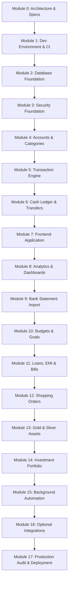

# Development Roadmap: Smart Family Budget Manager

This roadmap outlines the 18 sequential modules (Module 0 through 17) for building the Smart Family Budget Manager. In accordance with `AGENTS.md`, modules are executed strictly sequentially with two approval gates per module (Gate 1: Plan Approval; Gate 2: Module Approval).

---

---

## Phased Module Specifications

### Module 0: Requirements and Architecture (Current)
- **Objective**: Establish foundational documentation, threat modeling, ERD, architectural design, and operational agreements.
- **Dependencies**: None.
- **Tasks**:
  - Author `ARCHITECTURE.md`, `DATABASE_DESIGN.md`, `DEVELOPMENT_ROADMAP.md`, `THREAT_MODEL.md`.
  - Author baseline tracking files (`DEVELOPMENT_STATUS.md`, `MODULE_CHECKLIST.md`, `KNOWN_ISSUES.md`, `DECISIONS.md`, `SECURITY.md`, `SECURITY_CHECKLIST.md`).
  - Align clarifying questions and default assumptions with user.

### Module 1: Development Environment & CI
- **Objective**: Establish reproducible local developer environment and automated CI pipeline.
- **Dependencies**: Module 0.
- **Tasks**:
  - Initialize React + Vite frontend skeleton with Tailwind CSS and i18n setup.
  - Initialize FastAPI backend skeleton with Pydantic v2 and SQLAlchemy 2.x.
  - Setup Docker Compose for local PostgreSQL and app development.
  - Implement basic API health check (`/api/v1/health`).
  - Configure `.env.example`, `.gitignore`, and linting tooling (Ruff/Black, ESLint).
  - Setup automated GitHub Actions CI pipeline: linting, pytest, vitest, `pip-audit`, `npm audit`, Bandit, secret scanning.

### Module 2: Database Foundation
- **Objective**: Create core database schema, constraints, migrations, and tenant isolation tests.
- **Dependencies**: Module 1.
- **Tasks**:
  - Define SQLAlchemy models: `users`, `households`, `household_members`, `invitations`, `user_sessions`, `financial_accounts`, `categories`, `transactions`, `transfer_groups`, `audit_logs`, `security_events`.
  - Create baseline Alembic migration script.
  - Implement CHECK constraints, foreign keys, and indexes.
  - Write test suite verifying foreign key constraints, unique constraints, and schema invariants.
  - Evaluate and implement PostgreSQL Row-Level Security isolation tests.

### Module 3: Security Foundation
- **Objective**: Deliver bulletproof identity, session management, CSRF defense, and RBAC authorization.
- **Dependencies**: Module 2.
- **Tasks**:
  - Implement Argon2id password hashing and user registration/onboarding logic.
  - Implement server-side session management (cookie issuance, rotation, idle timeout, "log out everywhere").
  - Implement CSRF double-submit / token validation middleware for state-changing calls.
  - Implement RBAC (Owner, Administrator, Member, Read-only member) and visibility filtering (`private` vs `shared`).
  - Implement login rate limiting and lockout mechanism.
  - Implement `security_events` logging.
  - Comprehensive security test suite: authorization matrix, IDOR 404 tests, brute force throttling.

### Module 4: Financial Accounts and Categories
- **Objective**: Enable management of financial accounts and hierarchical categories with validation.
- **Dependencies**: Module 3.
- **Tasks**:
  - Endpoints for creating, updating, listing, and deactivating accounts (`cash`, `savings`, `current`, `credit_card`, `other`).
  - AES-256-GCM encryption service for sensitive account identifiers (last 4 cleartext).
  - Default Indian category taxonomy (e.g., Groceries, Fuel, Electricity, EMI, Gold, Salary).
  - Custom category creation and hierarchy (parent/subcategories).
  - Optimistic locking and validation tests.

### Module 5: Transaction Management
- **Objective**: Core transaction recording, editing, querying, and attachment linking.
- **Dependencies**: Module 4.
- **Tasks**:
  - API endpoints for CRUD transactions (Income, Expense, Refund, Loan, Investment).
  - Filtering by date range, account, category, user, and visibility.
  - Pagination and sorting with SQL indexing.
  - Idempotent transaction creation (`idempotency_key`).
  - Optimistic concurrency control (`version` check).
  - Secure attachment upload and private file storage with SHA-256 hash de-duplication.

### Module 6: Cash Ledger and Transfers
- **Objective**: Implement robust double-entry transfer engine and cash tracking.
- **Dependencies**: Module 5.
- **Tasks**:
  - Atomic double-leg transfers using `transfer_groups`.
  - ATM cash withdrawals (Bank Outflow -> Cash Inflow) and Cash deposits.
  - Credit card liability settlement logic (Bank Outflow -> Credit Card Inflow).
  - Opening balance workflows.
  - Void and reversal operations with immutable audit trail.
  - Financial scenario tests (Blueprint ₹150 cash expense, cash income, ATM withdrawal, card payments).

### Module 7: Frontend Application
- **Objective**: Build responsive, accessible, mobile-friendly UI for family members.
- **Dependencies**: Module 6.
- **Tasks**:
  - Responsive layout: desktop sidebar, mobile bottom navigation, header with household switcher.
  - Auth flows: login, session restoration, logout everywhere.
  - Account list and management with live derived balances.
  - Transaction log with filters, search, and pagination.
  - Quick-add transaction modal with Indian currency formatting (`₹1,00,000`).
  - Empty states, loading spinners, and error boundaries.
  - Internationalization setup (English strings prepped for future Tamil translations).

### Module 8: Dashboard and Analytics
- **Objective**: Financial visualization and summary metrics calculated strictly from SQL aggregation.
- **Dependencies**: Module 7.
- **Tasks**:
  - Monthly cash flow cards (Total Inflow, Total Outflow, Net Savings).
  - Expense breakdown by category and family member using Recharts.
  - Indian Financial Year (April - March) summary reports.
  - Verification test suite against hand-calculated financial scenarios.

### Module 9: Bank Statement Import
- **Objective**: Secure ingestion of bank statements with preview and deduplication.
- **Dependencies**: Module 8.
- **Tasks**:
  - File upload parser for CSV and Excel (safe parsing without formula injection).
  - Duplicate detection engine (amount, date, account, reference number matching).
  - Staging area: parse -> preview -> match categories -> review -> commit.
  - Import history log and rollback capability.

### Module 10: Budgets and Savings Goals
- **Objective**: Monthly category budgets and progress tracking toward targets.
- **Dependencies**: Module 9.
- **Tasks**:
  - Category budget limits with rollover support.
  - Real-time spend vs. budget calculation.
  - Threshold triggers (75%, 90%, 100% utilization).
  - Savings goal tracking (emergency fund, vehicle, vacation).

### Module 11: Loans, EMI and Bills
- **Objective**: Loan amortization tracking, recurring bill reminders, and schedule management.
- **Dependencies**: Module 10.
- **Tasks**:
  - Loan accounts with principal, interest rate, tenure, and calculated EMI schedule.
  - Bill calendar with date-only storage in Asia/Kolkata timezone.
  - One-click bill settlement linked to ledger transactions (no marking paid without ledger transaction).

### Module 12: Shopping Orders & E-Commerce Reconciliation
- **Objective**: Order-level tracking and refund reconciliation without double counting.
- **Dependencies**: Module 11.
- **Tasks**:
  - Record online orders (Amazon, Flipkart, Blinkit, etc.).
  - Multi-item order splitting across categories.
  - Return and refund tracking linked directly to original orders.
  - Anti-double-counting verification tests.

### Module 13: Gold and Silver Asset Tracking
- **Objective**: Manage physical precious metals portfolio tailored to Indian family wealth.
- **Dependencies**: Module 12.
- **Tasks**:
  - Track 24K, 22K, 18K gold and 999 silver in grams.
  - Manual price entry with source, date, and historical price log.
  - Current portfolio valuation and unrealized gains.

### Module 14: Comprehensive Investment Portfolio
- **Objective**: Unified view of FD, RD, Mutual Funds, Stocks, and EPF/PPF.
- **Dependencies**: Module 13.
- **Tasks**:
  - Portfolio tracking with manual valuation updates.
  - Inflow/outflow tracking (investments treated as asset movements, not expenses).
  - Absolute return and XIRR calculation.

### Module 15: Background Automation & Notifications
- **Objective**: Celery worker and Redis broker for asynchronous background tasks.
- **Dependencies**: Module 14.
- **Tasks**:
  - Deploy Redis container and Celery worker.
  - Scheduled jobs: daily bill reminders, budget overspend alerts, backup triggers.
  - Idempotent task dispatching to prevent duplicate notifications.

### Module 16: Optional Integrations (Privacy-Preserving)
- **Objective**: Add opt-in integrations with explicit consent and manual fallbacks.
- **Dependencies**: Module 15.
- **Tasks**:
  - Gmail receipt parsing (restricted read-only OAuth scope, user-consented).
  - Account Aggregator / SMS notification parser (local, zero external data leak).
  - AI receipt parsing / insights (strictly local models or optional user-keyed API).
  - Revocation workflows and manual entry fallback for all integrations.

### Module 17: Production Hardening, Audit & Deployment
- **Objective**: Final security validation, encrypted backups, deployment guides, and disaster recovery.
- **Dependencies**: Module 16.
- **Tasks**:
  - Hardened Docker Compose setup with non-root containers and read-only filesystems where possible.
  - Automated encrypted PostgreSQL backups (GPG/AES-256) and verified restore drills.
  - Data export (JSON/CSV) and complete household data deletion workflows.
  - Comprehensive security penetration testing & Bandit/audit review.
  - Production readiness checklist and handover documentation.
